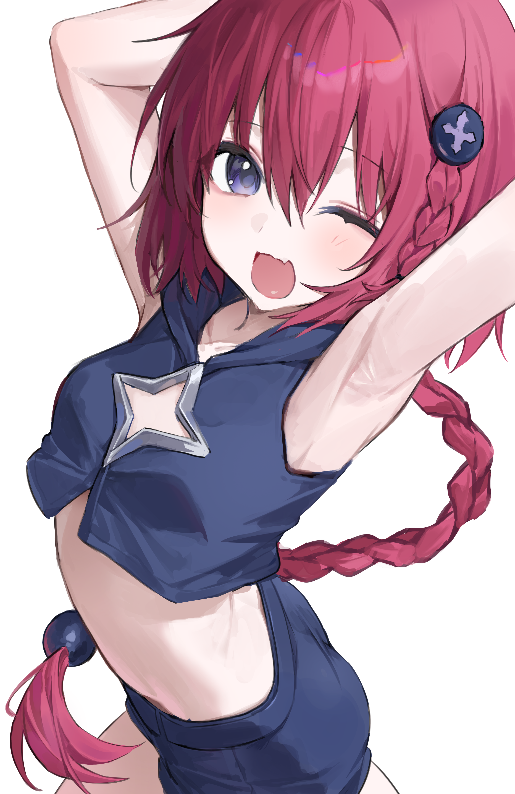

# 黒咲芽亜 | Kurosakimea

<strong>\> 一位普通的终极兵器·来自外太空～ \<</strong>

虽然如此，但还是希望自己能被更多人记住呢

 

## 🌸 碎碎念 | つぶやき

**Ciallo～(∠・ω< )⌒★** 

这里是 **misakiworst**  
叫我 **mea** 就可以啦～

一名在 **Canyon** 的 Structural R&D Engineer  
喜欢 **Manga·Anime·Linux**，十分期待 **AGI**  
沉迷 **Code，Arch，Galgame** 中

喜欢 **C/C++**，试图成为带动社区发展的一份子

尽力追求效率与完美，努力 ~~Vibe~~ Coding 中  ( ´ ▽ ` )ﾉ

虽然咱会的不多，但也正在认真扩展技能树ing：

- `C` & `C++` for _GKI 内核与模块化工具链等_
- `Kotlin` & `Flutter` for _Android 应用与 Root 生态等_
- `Rust` for _知识面拓展 (?)_
- `Python` & `PyTorch` for _LLM 推理、LoRA 训练与合并等_
- `Shell` & `Docker` for _自托管服务与 CI 自动化_
- `Cloudflare Workers` for _轻量云端小工具_

 

## 📊 GitHub 统计 | GitHub Stats

  <picture>
    <source media="(prefers-color-scheme: dark)" srcset="https://github-profile-summary-cards.vercel.app/api/cards/profile-details?username=MisakiWorst&theme=github_dark">
    
  </picture>

 

  <picture>
    <source media="(prefers-color-scheme: dark)" srcset="https://github-readme-stats-one-bice.vercel.app/api?username=MisakiWorst&locale=cn&role=OWNER%2CORGANIZATION_MEMBER%2CCOLLABORATOR&include_all_commits=true&count_private=true&show_icons=true&theme=default&hide_border=true&title_color=8FB8DE&icon_color=8FB8DE&text_color=c9d1d9&bg_color=0d1117">
    
  </picture>
  <picture>
    <source media="(prefers-color-scheme: dark)" srcset="https://github-readme-stats-one-bice.vercel.app/api/top-langs/?username=MisakiWorst&locale=cn&role=OWNER%2CORGANIZATION_MEMBER%2CCOLLABORATOR&hide=assembly%2Cmakefile%2Cperl%2Csmpl%2Cyacc%2Croff&langs_count=8&layout=compact&theme=default&hide_border=true&title_color=8FB8DE&text_color=c9d1d9&bg_color=0d1117">
    
  </picture>
   
  <picture>
    <source media="(prefers-color-scheme: dark)" srcset="https://streak-stats.demolab.com/?user=MisakiWorst&locale=zh_Hans&hide_border=true&ring=8FB8DE&fire=8FB8DE&currStreakLabel=8FB8DE&background=0d1117&stroke=0d1117&sideNums=c9d1d9&currStreakNum=c9d1d9&dates=8b949e&sideLabels=8b949e">
    
  </picture>

 

<picture>
  <source media="(prefers-color-scheme: dark)" srcset="https://raw.githubusercontent.com/MisakiWorst/MisakiWorst/output/github-contribution-grid-snake-dark.svg">
  <source media="(prefers-color-scheme: light)" srcset="https://raw.githubusercontent.com/MisakiWorst/MisakiWorst/output/github-contribution-grid-snake.svg">
  
</picture>

 

## 📚 正在学习 | Learning

  <picture>
    <source media="(prefers-color-scheme: dark)" srcset="https://skillicons.dev/icons?i=c%2Ccpp%2Crust%2Ckotlin%2Cpython%2Clinux%2Candroidstudio%2Cdocker%2Ccloudflare%2Cpytorch%2Cgithubactions&theme=dark&perline=11">
    
  </picture>

 

## 📬 联系方式 | Contact

 

<strong>☁️ 欢迎大家和mea一起交流，一起喝杯咖啡聊聊天～ ☁️</strong>

